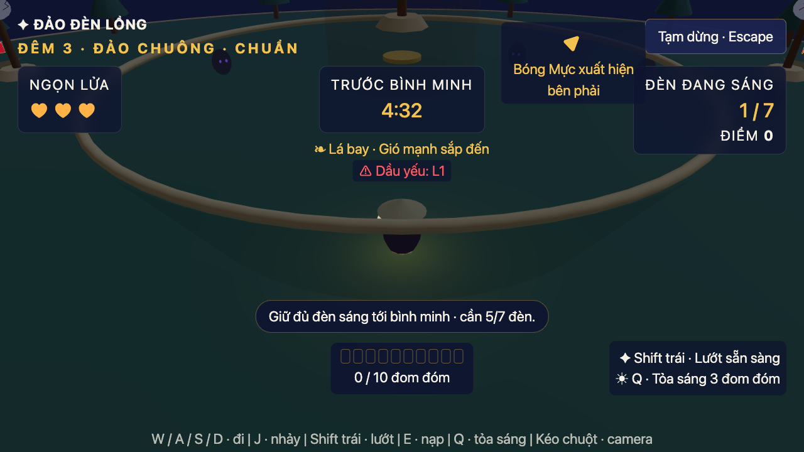

# Đảo Đèn Lồng v1.0.0

**Video demo: chưa quay — người dùng sẽ bổ sung.** [Bản phát hành v1.0.0](https://github.com/tu7749/K5-L3A-DAY12-DOANVANTU-2A202603595-AI-SDLC-Dao-Den-Long/releases/tag/v1.0.0)

Game3D góc nhìn thứ ba qua Đảo Bến, Đảo Cau, Đảo Chuông. Mây gom đom đóm, châm dầu và giữ ánh sáng giữa Bóng Mực/Gió Lạc. Mã nguồn dùng Node24/Three.js, Contract **1.3** theo bốn ticket. [Tài liệu lab](docs/LAB-README.md).



## Cài và chơi trên macOS/Linux

Cần Node.js24, npm, trình duyệt có WebGL (Chrome/Chromium hoặc Safari hiện đại), chuột và bàn phím. Máy đã kiểm tra: AppleM1,16GBRAM, macOSDarwin24.6, Node24.14.1. Các số đo máy này không thay số đo máy chấm.

Clone repo rồi chạy tại thư mục repo, tối đa3 lệnh:

```sh
npm ci
npm run build
npm start
```

Mở **http://localhost:4173**. Nếu cổng bận: `PORT=4174 npm start`. Sau cập nhật, dừng server cũ bằng Ctrl+C và chạy lại `npm start` để nhận API bảng điểm mới; tải lại trang. Cài xong không cần CDN.

Bản ZIP ở Release đã chứa thư viện: giải nén, chạy `node scripts/serve.mjs`, mở URL trên, không cần npm install. Hướng dẫn nằm trong README.txt của ZIP. Có thể host `dist/` riêng như web tĩnh.

## Studio demo để quay video

Bản `main` sau Release có công cụ demo; không sửa các tag đã nộp. Chạy `npm run build` rồi `npm start`, mở **http://localhost:4173/?demo** hoặc chọn **Studio demo** từ menu.

- Chọn trực tiếp cả3 Đêm và các cảnh minh họa tính năng Phase1–4: nhặt/thắp, bục/Bùa, Gió Lạc, hút dầu, tháp và Bình Minh; có nút mở Cài đặt/Bảng điểm Phase4.
- Công cụ: nạp đầy túi, hồi máu, thêm60s, châm dầu, đến đèn kế, thêm đom đóm/Bóng Mực, thắp tất cả. Cuộn panel xuống để bật bất tử, khóa giờ, đom đóm vô hạn, bỏ hồi chiêu, ánh sáng rõ, camera bay và khung hình gọn.
- Bấm **Đóng công cụ demo** trước khi quay; nhãn DEMO vẫn hiện. Đây là cảnh có can thiệp trên bản hiện tại, không phải phiên bản lịch sử hay bằng chứng chơi Chuẩn. Điểm demo không được lưu.
- Cài đặt → Đồ họa → **Quay demo** dùng pixel ratio tối đa1; Chất lượng cao1.5; Máy yếu0.75. Tái sử dụng geometry giảm cấp phát khi chuyển cảnh. Ánh sáng bổ sung chỉ có trong Studio; benchmark không bật công cụ demo.
- Chrome QA1280×720 ở DPR2: khoảng60FPS, geometry39→39 qua nhiều lần chuyển cảnh;73 test đạt. Xem docs/proof/demo-studio. Số đo/bảnZIP trong Releasev1.0.0 vẫn thuộc tag phát hành cũ.

## Điều khiển và luật

| Phím mặc định | Hành động |
| --- | --- |
| WASD | Đi theo camera; A trái, D phải |
| Kéo chuột | Xoay camera |
| Space | Nhảy |
| Shift | Lướt |
| E | Nạp, thắp lại hoặc châm dầu đèn nhận được gần nhất trong2m |
| Q | Tỏa Sáng, tốn3 đom đóm |
| Esc / P | Pause: tiếp tục, chơi lại, cài đặt, về menu |

Cài đặt đổi đủ9 hành động, từ chối phím trùng và có Khôi phục mặc định. Phím tùy chỉnh, âm lượng, độ nhạy chuột, bảng màu, giảm chuyển động và chữ lớn được lưu. Khi đổi phím pause, P chỉ là phím phụ nếu pause vẫn dùng Escape và P chưa được gán. Giao diện luôn hiển thị phím hiện dùng.

**Chế độ Hỗ trợ mặc định bật theo yêu cầu người chơi:** chạy9m/s,40 đom đóm ban đầu, sinh mỗi2s/trần60, thắp đủ mọi đèn thắng ngay và tự chuyển đảo. Có thể tắt trong Cài đặt, áp dụng khi bắt đầu/chơi lại Đêm. Nhãn HỖ TRỢ/CHUẨN ở cạnh tên đảo.

**Chế độ Chuẩn/headless/bench/soak:** tốc độ6m/s,20 đom đóm ban đầu, sinh4s/trần30. Đêm240/270/300s; cần3/5,4/6,5/7 đèn còn sáng lúc bình minh, không thắng sớm. Đèn mới cần10 đom đóm, dầu100 hao1/s; dưới30 mất safe6m và có thể bị hút thêm5/s/con. Tắt rồi chỉ cần5 để thắp lại. Capacity10+2 mỗi lần thắp thành công, tối đa20. Bùa tăng tốc/lướt, bục phóng qua đảo/tầng, Đêm3 có gió.

Điểm: mỗi đom đóm nạp/châm+5, thắp mới+100, thắp lại+40, pulse thường+5/con hoặc đang drain+15/con. Thắng cộng mỗi đèn sáng `50+floor(dầu)` và50 mỗi lửa; không thưởng thời gian. Tổng chỉ cộng các Đêm thắng. Hết lửa luôn thua trước.

## Bảng điểm và dễ tiếp cận

Sau khi thua hoặc vào Bình Minh, nhập tên3–12 ký tự `[A-Za-z0-9_]` để lưu. Top10 giảm dần theo điểm; bằng điểm thì người đạt trước đứng trên. Lưu name/score/nights_won/achieved_at có múi giờ/seed (seed hành trình42; mỗi Đêm42+night). Menu có Bảng xếp hạng và Xuất JSON.

Server lưu **`.local/leaderboard.json`** trên đĩa; vẫn còn sau restart. Xuất cùng dữ liệu bằng contract run_cmd:

```sh
node scripts/serve.mjs --export-leaderboard out.json
```

Khi host web tĩnh không có API, game dùng localStorage và nút Xuất JSON; CLI không đọc được dữ liệu trình duyệt. Dữ liệu cá nhân/bảng điểm không commit.

UI tối thiểu18px tại1280×720, chữ lớn×1.25. Bảng màu dễ phân biệt đổi viền/mắt Bóng Mực sang xanh lam, cảnh báo trắng kèm⚠. Đèn tắt xẹp20% và có nét rách. Giảm chuyển động tắt chớp/animation và dùng chỉ báo tĩnh cho dầu yếu. Có cảnh báo xuất hiện bóng kèm mũi tên mép màn hình, gió sắp tới,10s cuối và đèn dầu<30.

## Test và headless

```sh
npm run verify
node src/headless.mjs --seed 42 --night 2 --ticks 1200 --out /tmp/night2.jsonl --snapshot-every 10
```

`verify` hiện chạy73 test rồi build (Releasev1.0.0 có66 test); test đỏ chặn build. CI chạy lại test/build và soak. Headless chỉ cần Node, không cần GPU/Three.js. Hỗ trợ night1–3, scenario/inputs, sparse frames, nút theo cạnh. Snapshot0 trước input; pause tăng tick nhưng đóng băng sim_tick/timer. Invalid scenario/input mã2, lỗi runtime/output mã1. Tuning/lệnh chuẩn nằm trong [game.contract.json](game.contract.json).

Scenario hồi quy Phase3: `node scripts/proof-phase3.mjs` (ghi lại proof Phase3 khi chạy, muốn tái lập nguyên trạng cũ hãy checkout tag phase-3). Các bằng chứng Phase1/2/3 thuộc tag tương ứng; không đánh đồng output luật cũ với bản1.3.

## Benchmark chuẩn

Cần cài Chrome/Chromium riêng. Trình chạy tự tìm đường dẫn thông dụng trên macOS/Linux; nếu khác: đặt biến **CHROME_BIN** tới file thực thi. Benchmark mở cửa sổ Chrome app riêng1280×720, profile tạm, không dùng profile cá nhân. Cửa sổ tự đóng khi xong.

```sh
node scripts/bench.mjs --seed 42 --duration 30 --out bench.json
```

Cảnh Đêm1: đúng200 wander,100 motes, L1–L3 sáng dầu100, Mây đứng gốc. Tắt input/pickup/spawn/damage/decay/end và các chi tiết sáng tạo cây/mây trang trí; bóng vẫn wander chuẩn. Camera bán kính30m/cao15m, từ(30,15,0), vòng15s. Giữ ánh sáng, sương, mô hình và hiệu ứng render gameplay. Warmup3s, sau đó đo cửa sổ30s.

Chrome được yêu cầu tắt giới hạn frame/vsync qua `--disable-frame-rate-limit --disable-gpu-vsync`; bản web mở thường không thể tắt vsync bằng JavaScript. `avg_fps=1000*N/sum(dt)`, p1 dùng trung bình1% frame chậm nhất, p95 theo nearest-rank. Lưu thêm `bench.json.frames.json` để tính lại. `peak_mem_mb=null` theo ngoại lệ bản web: không thể quy RSS của nhiều tiến trình renderer/GPU cho một trang; RSS của Node driver không đại diện game.

Số đo tham khảo và cấu hình tại [docs/proof/phase-4](docs/proof/phase-4). Ngưỡng avg>=60, p1>=30, load<=10000ms do máy chấm quyết định. Không thay kết quả bằng hằng số.

## Soak

```sh
node --jitless --expose-gc --max-semi-space-size=1 scripts/soak.mjs --seed 7 --nights 10 --out soak.json
```

Cùng một process,10 Đêm1→2→3 xoay vòng; i bắt đầu0 dùng seed7+i. Mỗi30tick chọn hướng; xác suất mỗi tick nhảy5%,lướt3%,pulse2%,interact10%. Mỗi Đêm dừng terminal hoặc hết thời lượng; reset rồi mới đọc RSSend. Không có Hỗ trợ hoặc hiệu ứng thêm.

Lệnh công bố dùng Node interpreter (jitless), young heap1MB và GC tường minh mỗi300tick/sau reset. Soak mặc định JIT từng vượt ngưỡng RSS dù không crash; giữ kết quả đó ở `soak-default-runtime.json`. Lệnh chính thức đo RSS thực sau tải Đêm đầu và sau reset Đêm cuối, không nâng baseline hoặc chỉnh output. Ngưỡng crashes0, end<=1.2*start. Mười kết quả thua là kết quả bot ngẫu nhiên, không giả lập chiến thắng.

## Tài liệu và phát hành

- [Changelog đủ4 phase](CHANGELOG.md), [retro](docs/RETRO.md), [ghi chú/acceptance Phase4](docs/notes/phase-4.md), [checkpoint](CHECKPOINTS.md).
- [Bằng chứng](docs/proof/phase-4): bench.json + raw timing, soak.json, environment.json, browser.json, ảnh và verify.txt.
- `npm run package:release` tạo ZIP tại `release/dao-den-long-v1.0.0.zip`; runtime data và credentials không đi vào ZIP/Git.
- Tag phase-1/2/3 giữ nguyên; Phase4 dùng phase-4 và Releasev1.0.0. Deadline thực tế theo Coach; không sửa thời gian tag.
- Còn người dùng quay video.mp4 dưới5phút, chơi thật và cho thấy test/headless/bench; thêm vào Release hoặc docs/demo/demo.mp4 rồi đặt link đầu README. Chưa có playthrough thủ công trọn3 Đêm, chưa nghe audio bằng tai hoặc reviewer độc lập.

## Sáng tạo của tôi

Mây đội nón lá có đèn nhỏ, các đảo nổi/cây/mây procedural, vệt tỏa sáng, lời Ông Đăng, làm mờ tầng che Mây và chế độ Hỗ trợ. Cây/mây trang trí tắt trong benchmark; headless/soak không render. [CREDITS](CREDITS.md) ghi nguồn mọi asset/audio và công cụ; [LICENSE](LICENSE) áp dụng mã gốc, tài liệu lab giữ quyền tác giả.
